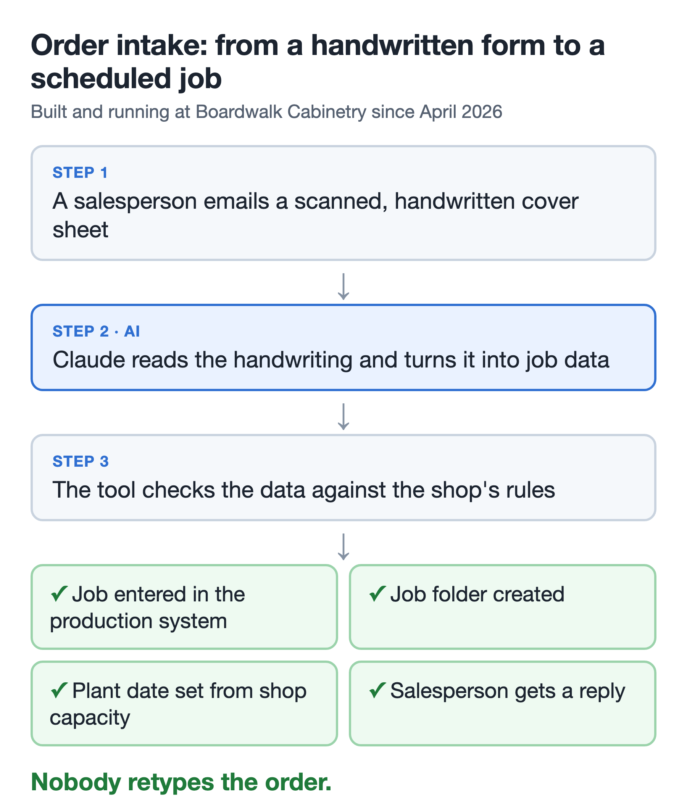
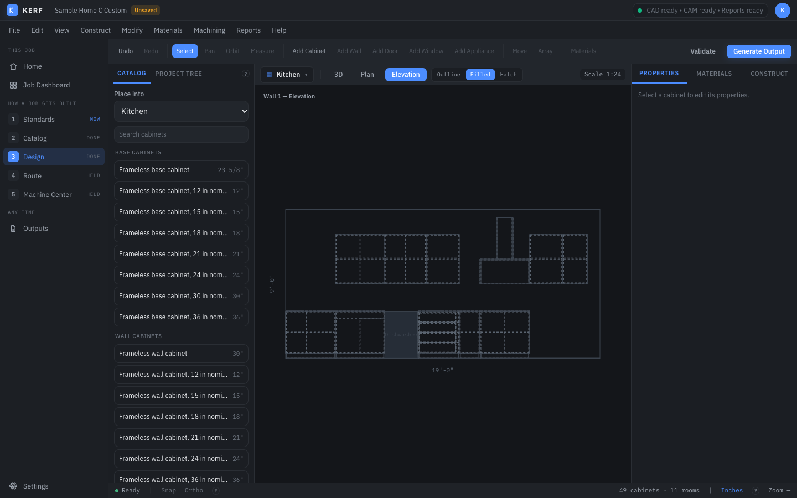
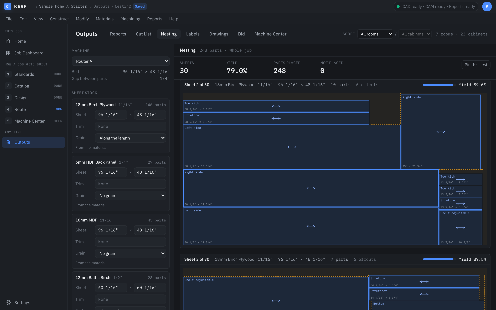
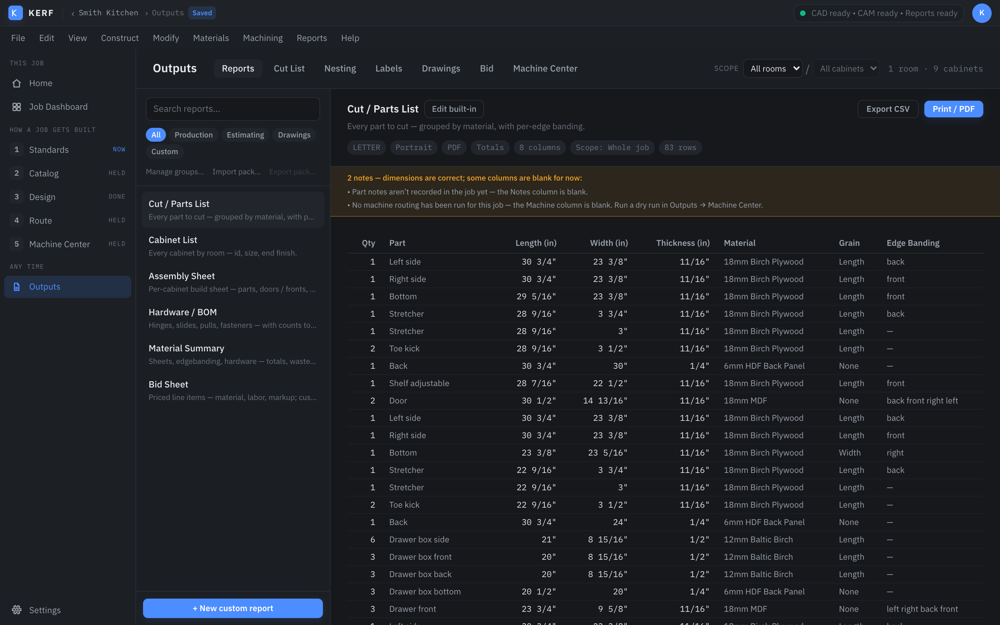

# Carter Caldwell

**Cabinet Designer and Software Developer | Cabinet Vision, UCS Scripting, AI Automation**

I'm a cabinet designer who builds the software around the shop. At Boardwalk Cabinetry I've built and deployed tools that automate order intake, hardware purchasing, engineering checks and production tracking, using Python, C#/.NET, SQL, AI APIs and Cabinet Vision UCS scripting. On my own time I'm building Kerf, design-to-CNC software that takes a cabinet from drawing to cut parts with fewer manual steps.

My focus is practical, reliable software that solves real problems on the shop floor.

[LinkedIn](https://www.linkedin.com/in/carter-caldwell-399669400)

## What I build

| Problem | What I've built |
|---|---|
| Paperwork retyped by hand | AI that reads handwritten order forms into the production system |
| Shop knowledge living in people's heads | Cabinet Vision UCS scripts, and construction rules in Kerf |
| Errors caught too late | Automated checks on drawers, doors and cabinet dimensions |
| Manual purchasing | An AI ordering agent with a person approving every order |
| Old, fragile shop software | A rebuilt production tracking app, running in the shop today |
| Drawing to CNC | Kerf: parts, cut lists, nesting, labels and G-code |

## How I work

I use AI coding agents for much of the implementation. I set the requirements and construction rules, make the design decisions, review the changes, and test before I deploy: on the shop floor for Boardwalk's tools, and with automated tests and sample jobs for Kerf.

---

## Production tools at Boardwalk Cabinetry

I work full-time as a Cabinet Designer at Boardwalk Cabinetry. Every tool below is in use in the shop today.

> **Why there's no code here:** I built these tools for my employer, so the code belongs to Boardwalk Cabinetry and stays in their private repositories. The descriptions are my own. I'm happy to walk through how any of them work on a call.

### Order-intake automation

Orders reach the shop as scanned, handwritten cover sheets. Before this tool, every order was typed into the production system by hand, and entry mistakes were frequent. Now nobody types the order in, and those mistakes are very rare.

<p align="center"></p>

- A scheduled Python job watches the orders inbox and sends each cover sheet to the Claude API, which reads the handwriting into structured job data.
- The data is checked, then the job is entered into the shop's production system, its folder is created, a plant date is set from shop capacity, and the salesperson gets a reply.
- It has a dry-run mode and its own test suite, and it has run every day since April 2026.
- I also built the **order prep tool** the sales team uses with it, and I keep improving both.

### Weekly hardware-ordering agent

Every Monday I start an AI agent that does the shop's hardware purchasing. It works in the supplier's website through a browser, following a written procedure I maintain.

- **Reads each job's hardware sheet** and orders only the quantities a person has marked, including hand-corrected counts.
- **Cross-checks** part numbers and counts against the job's material summary and cover sheet, and checks the cost against what we bid.
- **Stops and asks** when the sheet and the specs disagree, instead of guessing.
- **Keeps job orders and stock orders separate**, so stock items never land on a job's purchase order.
- **Nothing is ordered without my approval.** It builds every cart first and shows me the whole week's orders at once.
- After I approve, it places each order with the right PO and delivery date, confirms the PO landed on the order, files the receipt in the job folder, and flags any backordered item against the job's due date.

It turns hours of weekly ordering into a single review.

### Cabinet Vision UCS scripts

Shop rules written into Cabinet Vision so they happen automatically:

- Hardware and its cost can be set on any room, cabinet, part or opening, and the exact pull number and cost print on the material summary, with no catalog entry needed for each item.
- Sheet orders follow the actual nested sheet count from the CNC output, not Cabinet Vision's internal estimate.
- A check flags drawers that need a drawer stretcher or fixed shelf above them but don't have one.
- A check flags doors that don't match the room or job specs.

I also maintain the shop's construction methods and machining rules.

### Production tracking app rebuild

I rebuilt the shop's production tracking app, moving it from .NET Framework 4.8 to .NET 10 with a new Avalonia interface that runs on Linux. It's the version the shop runs today. It's faster, crashes far less, adds features departments asked for, and improves the app's security.

### Shop IT

I set up a Linux container server with Raspberry Pi endpoints to replace shop computers that were dying from sawdust. The Pis are faster and cheaper than the PCs they replaced.

---

## Kerf: design-to-CNC software for cabinet shops

On my own time, with my employer's permission, I'm the owner and lead developer of **Kerf**, a desktop app for cabinet shops with AI and automation at its core. I set the roadmap and the construction rules, write much of the code, and direct AI coding agents through written specs, tests and CI.

**Kerf is pre-release and not yet in customer use.** Where it stands:

| Working end to end in the current development build | Not done yet |
|---|---|
| Draw rooms and cabinets in plan, elevation and 3D | Programs for a specific shop's CNC controller (output today is generic G-code) |
| Cabinets built down to their individual parts from the shop's construction rules | Simulating material removal before a program runs |
| Cut lists and printable reports | Testing on real production machines |
| Sheet nesting, part labels and generic G-code | Use by a customer shop |

**A kitchen wall drawn in elevation**



**Every part nested onto sheets, with sheet count and yield**



**The cut list, grouped by material with edge banding**



*Screenshots use sample jobs, not customer data.*

---

## Code samples (Kerf, Python)

Short excerpts. Comments are condensed for length.

### A construction rule, turned into part sizes and proven by a test

When a cabinet's deck and top sit in dados, those panels have to be cut longer, by exactly the depth of both dados, or the cabinet won't close. My rule for this: *"Dados must never appear in a cut list whose panel lengths don't seat in them."*

The rule, with a guard against an impossible setting:

```python
def _carcass_joint_depth(s: CabinetStandards) -> float:
    """How far each captured horizontal reaches INTO the sides, mm.

    THE TWO MUST AGREE. If this returns a depth the machining step does not cut,
    the panel is machined long and will not close; if a recess is cut that this
    does not compensate, the panel is short and the carcass has a gap at every seam.
    """
    if s.carcass_joint != "dado":
        return 0.0
    # A recess deeper than the side it is cut into is not a joint -- it is a slot
    # straight through the panel. Refuse it instead of lengthening every panel.
    if s.dado_depth_mm >= s.panel_mm:
        raise ValueError(
            f"carcass dado {s.dado_depth_mm:.1f}mm is deeper than the "
            f"{s.panel_mm:.1f}mm side it is cut into — check the dado rule"
        )
    return s.dado_depth_mm
```

Where it sizes the parts:

```python
# A dado'd carcass seats the deck (and a full top) INTO the sides, so those
# panels are cut 2 * jd longer than the clear span and start jd earlier.
# Stretchers are deliberately NOT compensated: they still butt.
jd = _carcass_joint_depth(s)
jointed_len = inner + 2 * jd
jointed_x = t - jd
```

And the tests that hold it in place:

```python
def test_dado_lengthens_the_wall_deck_and_top_by_two_depths() -> None:
    s = _std("dado")
    butt = build_wall(width_mm=600, height_mm=760, depth_mm=350, s=_std("butt"))
    dado = build_wall(width_mm=600, height_mm=760, depth_mm=350, s=s)
    for role in ("bottom", "top"):
        assert _role(dado, role).length_mm == pytest.approx(
            _role(butt, role).length_mm + 2 * s.dado_depth_mm
        ), role


def test_the_panel_reaches_into_both_sides_and_spans_the_same_opening() -> None:
    """Asserting only the length would pass for a panel lengthened at one end
    only, which would seat in one side and foul the other."""
    s = _std("dado")
    built = build_wall(width_mm=600, height_mm=760, depth_mm=350, s=s)
    deck = _role(built, "bottom").solid.bounding_box()
    left = _role(built, "left_side").solid.bounding_box()
    right = _role(built, "right_side").solid.bounding_box()
    assert float(deck.min.X) == pytest.approx(float(left.max.X) - s.dado_depth_mm)
    assert float(deck.max.X) == pytest.approx(float(right.min.X) + s.dado_depth_mm)
```

### G-code that tells the operator what it is

Kerf's generic G-code says plainly what has and hasn't been checked, so nobody at the machine mistakes it for something it isn't.

```python
def on_open(self, ctx: EmitContext) -> list[str]:
    return [
        _comment(
            f"KERF generic-gcode {self.version} job {ctx.program.job_id} "
            f"machine {ctx.machine.name}"
        ),
        _comment(
            "GENERIC G-CODE - not the shop's controller dialect. "
            "Material removal was NOT simulated. Operator dry-run required."
        ),
        _comment(
            "Frame: part-local mm, Z0 at the spoilboard, stock top at Z=thickness, "
            "XY origin at the part's min corner = machine origin"
        ),
        "G17 G21 G40 G49 G54 G90 G94",
    ]
```

---

## Other projects

- **[scan2print](https://github.com/Sunst0n3/scan2print):** turns a phone video into a true-to-scale 3D model (Python, OpenCV).
- **[Issho](https://github.com/Sunst0n3/issho):** a Japanese-learning web app with kanji handwriting checks and spaced repetition.
- **Meros:** an AI meal-planning iOS app in private beta (React Native, Node.js, Python, Claude API).

## Skills

Cabinet Vision (UCS scripting, construction methods, machining rules) · AutoCAD · C# / .NET · Python · SQL · TypeScript · AI agents and LLM APIs · Linux · Docker · Git
